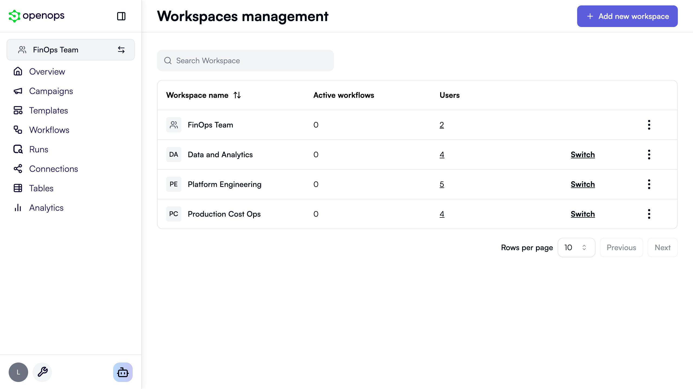
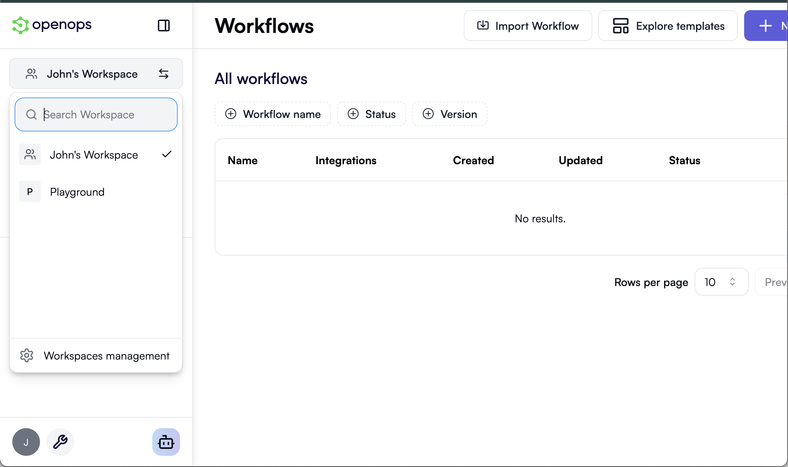
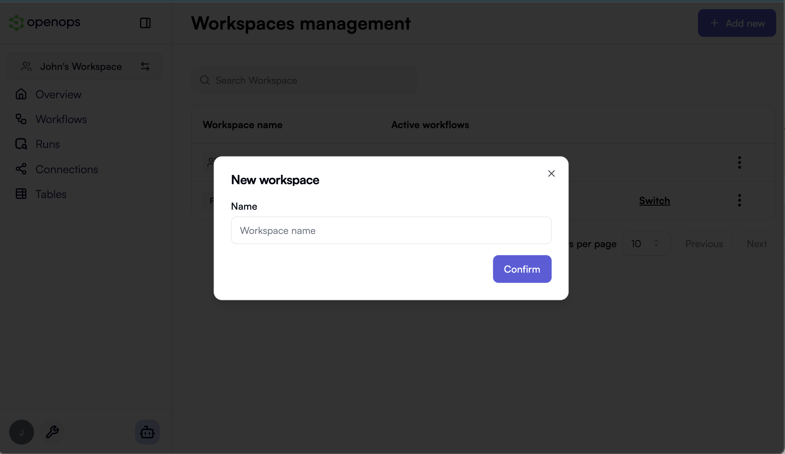
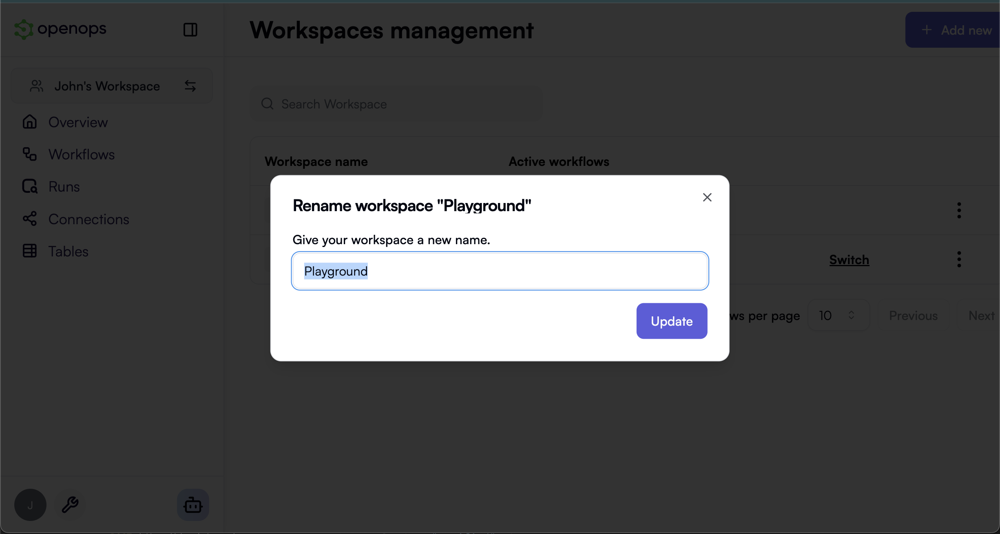
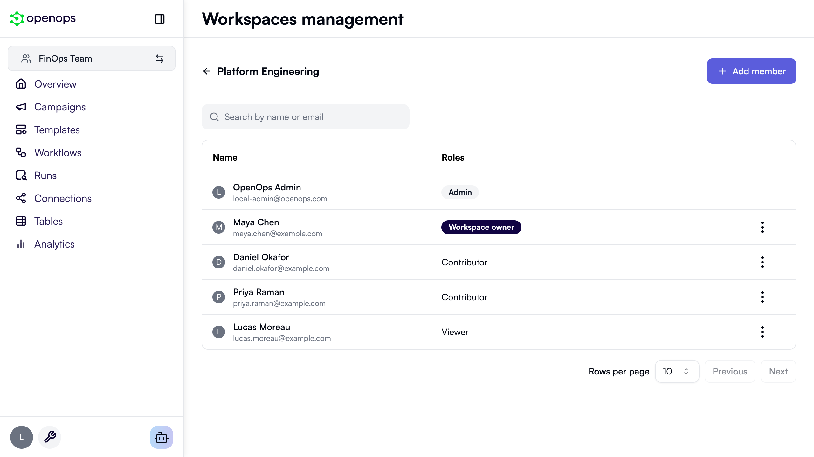
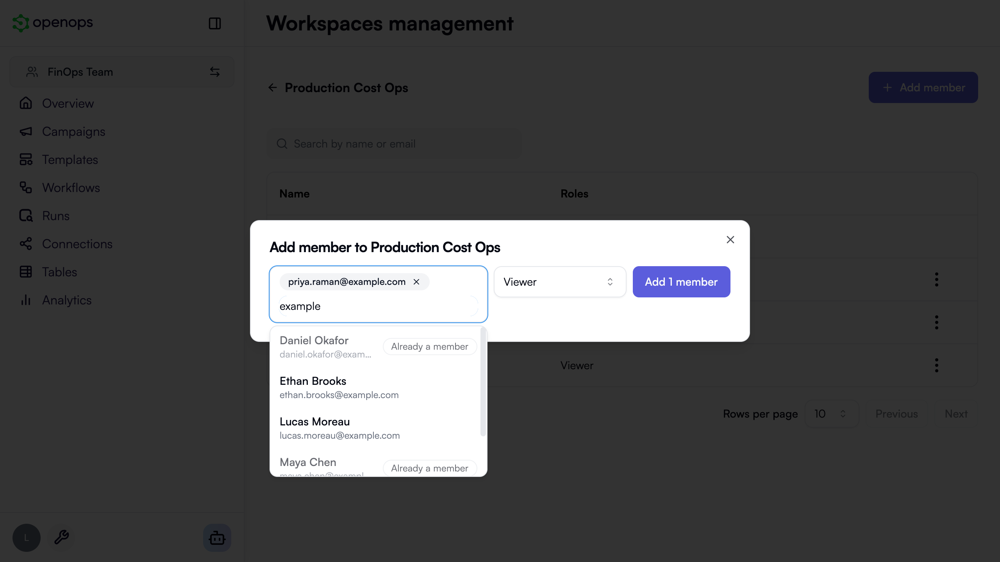
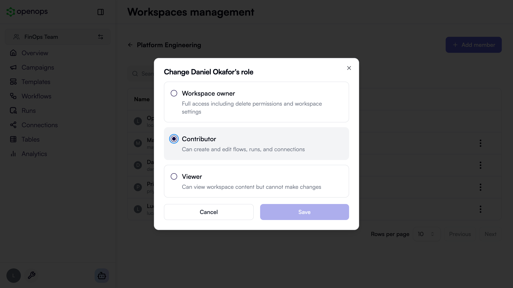
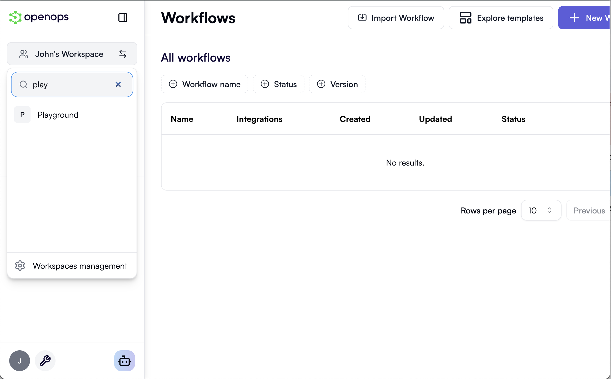

import { NarrowImage } from '/snippets/narrow-image.jsx'

<Info>**Customer workspaces** is an Enterprise edition feature. See [pricing](https://www.openops.com/pricing/) for details.</Info>

Customer workspaces allow you to organize work in separate, isolated environments. Each workspace contains its own workflows, connections, and tables. This enables organizations to separate different projects, clients, or departments while maintaining clear boundaries between them.

In larger organizations, workspaces help teams organize their work by business unit, environment (dev/staging/production), or client. Central teams can create workspaces for different departments, each with its own workflows and data.

For managed service providers (MSPs), customer workspaces are essential for maintaining strict separation between client data and workflows, ensuring each client's work remains isolated and secure.

## Accessing Workspaces

Every user has a default workspace that opens when they sign in. You can access workspaces through the **workspace switcher** in the top navigation bar.

You can also navigate to the **Workspaces Management** page to view all workspaces in a table, create new ones, and manage existing workspaces.

## Creating a New Workspace

To create a new workspace:

1. Navigate to the **Workspaces Management** page
2. Click the **"Add new"** button
3. Enter a unique workspace name (at least 1 character)
4. Click **"Confirm"**

You will automatically become the owner and be switched to the new workspace. The system creates a dedicated database and authentication tokens for the workspace.

## Switching Between Workspaces

You can switch workspaces by:

- Clicking the workspace name in the top navigation bar and selecting a workspace from the dropdown
- Clicking the **"Switch"** button next to a workspace in the Workspaces Management page

The current workspace is marked with a checkmark (✓). The application reloads when switching workspaces to ensure all data and resources are properly loaded for the selected workspace.

## Managing Workspaces

### Workspace Information

The Workspaces Management page displays for each workspace:

- Workspace name
- Number of active workflows
- Number of users
- The action menu (⋯), shown only if you are a Workspace owner or Admin in that workspace

### Renaming a Workspace

Only Workspace owners and Admins can rename workspaces:

1. In the Workspaces Management page, click the three-dot menu (⋯) on the workspace row
2. Select **"Rename"**
3. Enter a new unique name
4. Click **"Update"**

### Deleting a Workspace

Only Workspace owners and Admins can delete workspaces. Deleting a workspace permanently removes its workflows, connections, and tables, and can't be undone.

1. Switch to a different workspace. You can't delete the workspace you are currently in.
2. In the Workspaces Management page, click the three-dot menu (⋯) on the workspace row
3. Select **"Delete"**
4. Click **"Delete"** to confirm

OpenOps refuses to delete a workspace and shows the reason in the dialog if:

- The workspace has published workflows. Unpublish them first.
- It is the organization's [master project workspace](#master-project-workspace).
- It is the default workspace of any of its members.
- It is the only workspace of any of its members.

### Default Workspace

Every user has a default workspace. By default, this is the organization's [master project workspace](#master-project-workspace). If your environment is configured to create personal workspaces, each new user gets their own workspace instead (initially named "[Your Name]'s Workspace"). Default workspaces appear first in lists and are marked with a users icon in the workspace switcher.

## Managing Workspace Members

Each workspace has a members page that lists who has access to it and their workspace role. To open it, click the number in the **Users** column, or click the three-dot menu (⋯) on the workspace row and select **"Manage members"**.

Every member can view the member list. Only Workspace owners and Admins can add, change, or remove members.

### Workspace Roles

- **Workspace owner** — Full access, including managing members and renaming or deleting the workspace
- **Contributor** — Can create and edit workflows, runs, and connections
- **Viewer** — Can view workspace content but can't make changes
- **Admin** — Organization admins automatically have the Admin role, with the same permissions as Workspace owners, in every workspace they belong to. You can't assign or change this role on the members page; it follows the user's [organization role](/paid/user-management#organization-roles).

For the full list of permissions, see [Role-Based Access Control](/paid/role-based-access-control).

### Adding Members

You can add users who already belong to your organization. To add a new person to your organization, see [Adding users to the organization](/paid/user-management#adding-users-to-the-organization).

1. On the members page, click **"Add member"**
2. Search for users by name or email and select one or more of them. Users who are already members are greyed out.
3. Select the role to give them
4. Click **"Add"**

### Changing a Member's Role

1. On the members page, click the three-dot menu (⋯) on the member's row
2. Select **"Change role"**
3. Select **Workspace owner**, **Contributor**, or **Viewer**
4. Click **"Save"**

The new role takes effect the next time the member signs in or switches workspace.

### Removing Members

1. On the members page, click the three-dot menu (⋯) on the member's row
2. Select **"Remove"**
3. Click **"Remove"** to confirm

### Rules for Managing Members

To keep every workspace manageable, OpenOps enforces these rules:

- You can't change your own role or remove yourself from a workspace.
- The user who created a workspace must stay its Workspace owner. They can't be demoted or removed.
- A workspace must keep at least one Workspace owner or Admin. Assign another Workspace owner before you demote or remove the last one.
- You can't remove a member from their default workspace or from their only workspace.

### Master Project Workspace

Each organization has one designated **Master Project** workspace that provides access to special organization-wide features. You must switch to the master project workspace to access these features.

By default, new users are added to the master project workspace as Contributors, and it becomes their default workspace. If your environment is configured to create personal workspaces, new users start in their own workspace instead, and a Workspace owner or Admin must [add them](#adding-members) to the master project workspace.

#### Analytics Access

**OpenOps Analytics** is only accessible when switched to the master project workspace. All users who have access to the master project can view analytics, regardless of their role.

#### Organization Template Catalog Management

Only organization **admins** in the master project workspace can create, edit, delete, and publish private templates to the organization catalog (requires private template editor feature to be enabled).

## Searching Workspaces

Use the search bar in the workspace switcher or the Workspaces Management page to filter workspaces by name. Search is case-insensitive and matches partial names.

