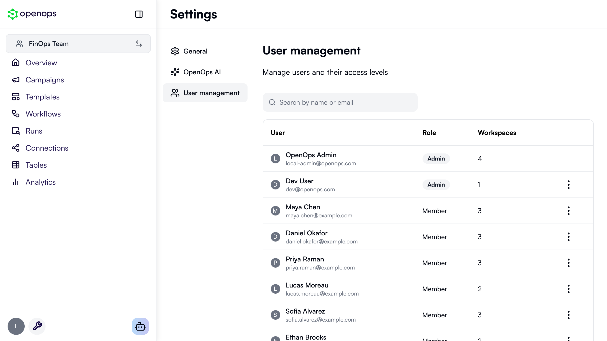
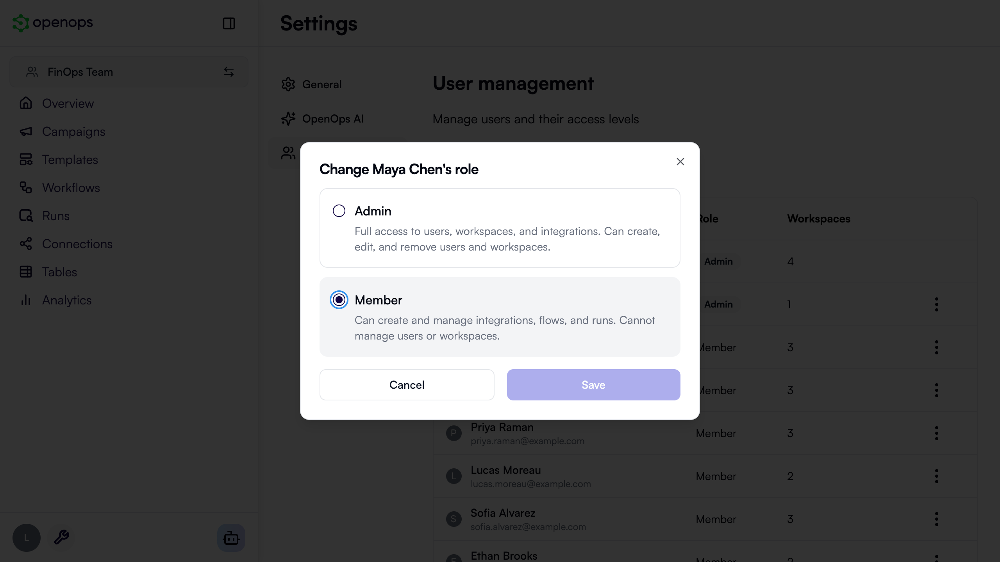

<Info>**User management** is an Enterprise edition feature. See [pricing](https://www.openops.com/pricing/) for details.</Info>

The **User management** page lists every user in your OpenOps organization and lets organization admins change each user's organization role. Use it to see who has access to your environment, how many workspaces each user belongs to, and who can manage users and workspaces.

To control what a user can do inside a specific workspace, use the workspace's members page instead. See [Managing workspace members](/paid/customer-workspaces#managing-workspace-members).

## Opening the User management page

Only organization admins can open this page:

1. Click the **Settings** icon (wrench) at the bottom of the sidebar.
2. Select the **User management** tab.

The page shows each user's name, email, organization role, and the number of workspaces they are a member of. Use the search box to filter users by name or email.

## Organization roles

Each user has one of two organization roles:

* **Admin** - Full access to users, workspaces, and integrations. Can change other users' organization roles, create and delete workspaces, and manage workspace members.
* **Member** - Can create and manage integrations, workflows, and runs in the workspaces they belong to. Cannot manage users.

For the full list of permissions, see [Role-Based Access Control](/paid/role-based-access-control).

## Changing a user's organization role

1. On the **User management** page, click the three-dot menu (⋯) on the user's row.
2. Select **Change role**.
3. Select **Admin** or **Member**.
4. Click **Save**.

The new role takes effect the next time the user signs in or switches workspace.

Changing the organization role also updates the user's role in every workspace they belong to:

* **Promoting to Admin** gives the user the Admin role in all of their workspaces.
* **Demoting to Member** makes the user a Workspace owner of the workspaces they created, and of any workspace where no one else can manage members. In all other workspaces, they become a Contributor.

### Rules for changing roles

To make sure your organization always has someone who can manage it, OpenOps enforces these rules:

* You can't change your own organization role.
* You can't demote the last admin of the organization. Promote another user to Admin first.

## Adding users to the organization

How users join your organization depends on how your environment signs users in:

* **With [SSO](/paid/sso-authentication)**, users are added automatically the first time they sign in through your identity provider.
* **Without SSO**, an admin creates each user account through the API. See [User Management](/getting-started/user-management#creating-new-user-accounts) for the API calls.

By default, a new user joins your organization's [master project workspace](/paid/customer-workspaces#master-project-workspace) as a Contributor. If your environment is configured to create personal workspaces, the new user gets their own workspace instead. After that, workspace owners and admins can add the user to other workspaces from each workspace's members page.

<Tip>To change how new users are onboarded in your environment, contact your OpenOps account manager.</Tip>
