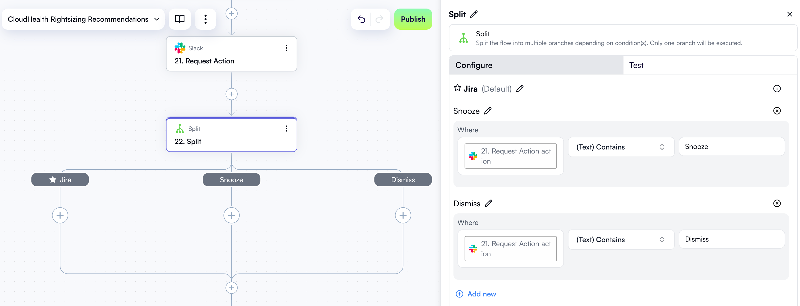
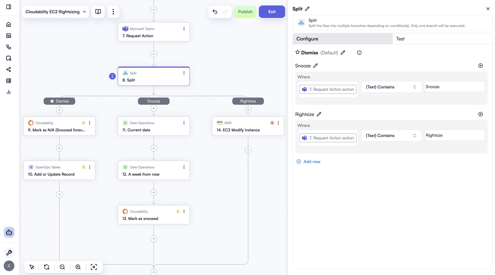
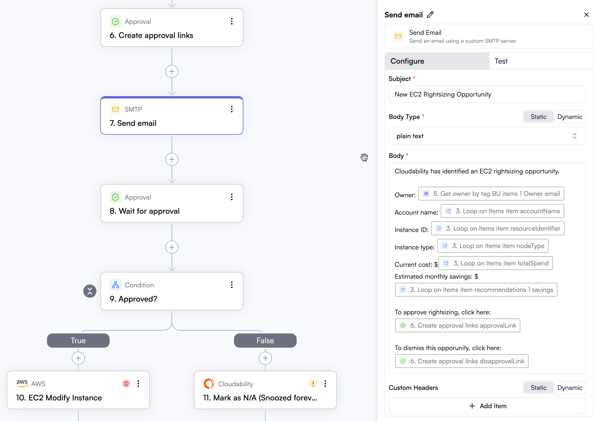
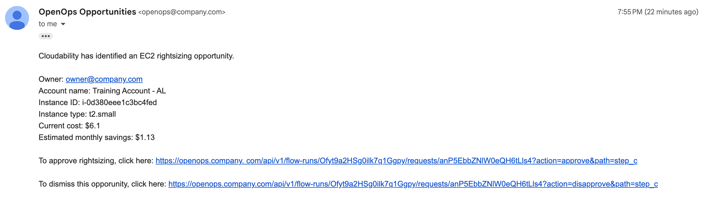

import { NarrowImage } from '/snippets/narrow-image.jsx'

Some workflows can run safely in unattended mode. Others, such as resource deletions, are more impactful and may require review by stakeholders before proceeding. To address this, OpenOps offers two Human-in-the-Loop mechanisms: [approvals](#requesting-approvals) and [notifications](#sending-notifications).

For example, you can create a workflow that flags idle RDS instances for review, prompting human approval before any scaling down or termination actions are taken.

## Requesting approvals

You can automate sending your stakeholders messages with actionable links or buttons and make your workflow stop executing until the receiver clicks one of these links or buttons. Depending on their choice, you can split the subsequent steps of your workflow into conditional branches.

OpenOps offers dedicated approval request features for Slack and Microsoft Teams, as well as a more generic approval mechanism that you can use with other communication channels such as email.

### On Slack

OpenOps provides several Slack-related actions:
<NarrowImage src="/images/hitl-slack-actions.png" alt="Slack actions" />

#### With "Request Action"

One of Slack-related actions, **Request Action**, is the most straightforward way to request approval. It lets you build a Slack message with standard action buttons, send it to a chat or a public channel, and wait until the recipient clicks one of these buttons, signifying their decision:
<NarrowImage src="/images/cloudhealth/slack-request-action-properties-1.png" alt="Request action via Slack" />

When this action fires, the Slack user receives a message that you've defined in the action's properties. The message may look like this:
<NarrowImage src="/images/cloudhealth/slack-notification.png" alt="Slack message with an action request" />

As soon as the user clicks one of the buttons, your **Request Action** step receives this as the output. You can then create a [conditional branch](/workflow-management/conditional-branching/) with the **Split** action and implement distinct steps depending on which button the user clicked:


If you need more than a button click from the recipient, such as a reason or a comment, add a [follow-up form](#collecting-details-with-a-follow-up-form) to a button.

#### With "Send Message" and "Wait For User Action"

If you want to build approval requests with more customization options, you can use the **Send Message** action in the **Slack** block instead of **Request Action**.

The upside of **Send Message** is that it enables you to create approval requests using Slack's rich [Block Kit](https://api.slack.com/block-kit) UI framework.

However, **Send Message** doesn't wait for a reply from the recipient. Instead, use the **Wait For User Action** action and pass the output of **Send Message** to it. This allows the workflow to capture button clicks in the approval request. Once a button click associated with a decision is captured, you can then use the **Split** action to add workflow steps depending on the decision.

### On Microsoft Teams

OpenOps provides the following actions in its Microsoft Teams block:
<NarrowImage src="/images/hitl-teams-actions.png" alt="Microsoft Teams actions" />

**Request Action** is the action you can use to request approval. It lets you build a Teams message with action buttons, send it to a chat or a channel, and wait until the recipient clicks a button to convey a decision:
<NarrowImage src="/images/hitl-teams-request-action-properties.png" alt="Request action via Microsoft Teams" />

When this action runs, the Microsoft Teams user or channel receives a message that you've defined in the action's properties. The message may look like this:
<NarrowImage src="/images/hitl-teams-message.png" alt="MS Teams message with an action request" />

When the user clicks one of the buttons, your **Request Action** step receives the selection as its output. You can then create a [conditional branch](/workflow-management/conditional-branching/) with the **Split** action and implement different steps depending on which button the user clicked:


As with Slack, you can add a [follow-up form](#collecting-details-with-a-follow-up-form) to a button to collect more details from the recipient.

### Collecting details with a follow-up form

Sometimes a button click isn't enough: you may want the recipient to give a reason for their decision or provide a missing detail, such as the email of the right owner. For this, any button in the **Request Action** action for Slack or Microsoft Teams can open a form in the recipient's browser. The workflow continues only after the recipient submits the form.

To add a form to a button, describe the form as JSON in the button's **Follow-up form** property:
<NarrowImage src="/images/hitl-follow-up-form-properties.png" alt="Follow-up form property of an action button" widthPercent={50} />

Here's the full JSON from the example above:

```json
{
  "title": "Why are you dismissing this?",
  "fields": [
    {
      "name": "reason",
      "label": "Reason",
      "type": "select",
      "options": ["Still in use", "Scheduled for decommissioning", "Other"]
    },
    {
      "name": "comment",
      "label": "Comment",
      "type": "textarea",
      "required": false,
      "hint": "Add any details that help us follow up"
    }
  ]
}
```

The form JSON supports the following properties:

| Property    | Required | Description                                                                         |
|-------------|----------|-------------------------------------------------------------------------------------|
| `fields`    | Yes      | The list of fields to show, in order. A form can have up to 10 fields.              |
| `title`     | No       | The heading of the form.                                                            |
| `subtitle`  | No       | A line of text under the heading.                                                   |
| `skipLabel` | No       | Adds a second button with this text that lets the recipient submit an empty form.   |

Each field supports the following properties:

| Property   | Required          | Description                                                                                                         |
|------------|-------------------|---------------------------------------------------------------------------------------------------------------------|
| `name`     | Yes               | The name under which the answer is returned to the workflow. Use letters, digits, and underscores, starting with a letter. |
| `label`    | Yes               | The text shown above the field.                                                                                     |
| `type`     | Yes               | One of `text`, `email`, `number`, `select` (a dropdown), or `textarea` (multi-line text).                           |
| `options`  | For `select` only | The list of values to choose from.                                                                                  |
| `required` | No                | Fields are required by default. Set to `false` to make a field optional.                                            |
| `hint`     | No                | Help text shown under the field.                                                                                    |

When the recipient clicks the button, the form opens in their browser:
<NarrowImage src="/images/hitl-follow-up-form.png" alt="Follow-up form opened from an action button" />

After the recipient submits the form, the answers are available in the output of the **Request Action** step under `parameters`, one entry per field name. In the example above, these are `parameters.reason` and `parameters.comment`. You can use them in subsequent steps like any other step output.

<Note>
The form is passed to the browser in the button's link, and Slack limits the length of a link to 3,000 characters. If a form is too large for a Slack button, the step fails without sending the message. In this case, shorten the form, for example by reducing the list of options.
</Note>

### By email

To request approvals through other communication channels, such as email, use the **Approval** block of actions:
<NarrowImage src="/images/hitl-approval-actions.png" alt="Approval actions" />

In this case, you can create the approval part of your workflow as follows:
1. Add the **Create Approval Links** action from the **Approval** block. This action generates two links: one for approval and one for disapproval.
2. Add an action to send the two links to a stakeholder. For example, you can use **Send Email** from the **SMTP** block or **Send Email** from the **Microsoft Outlook** block.
3. Add the **Wait For Approval** action from the **Approval** block. Once the stakeholder clicks a link, this action updates the approval status accordingly.
4. Add the **Condition** action to define steps for approval and disapproval.

Here's a sample workflow that uses **Create Approval Links**, delivers an email notification using **Send Email** from the **SMTP** block, and then proceeds based on the output of the **Wait For Approval** action:


The email with approval links may look like this:


## Sending notifications

Besides approvals, you can also send notifications about completed workflows or steps. Some of the actions that enable sending notifications include:
* Actions in the **Slack** block:
    * **Send Message** to send a direct message or a message to a public Slack channel.
    * **Update Message** to update a message previously sent to a public Slack channel.
* **Send Channel Message** and **Send Chat Message** under **Microsoft Teams**.
* Actions in the **Jira Cloud** block, such as **Change Issue Status** and **Add Issue Comment**.
* Actions to send emails under **SMTP** and **Microsoft Outlook**.
